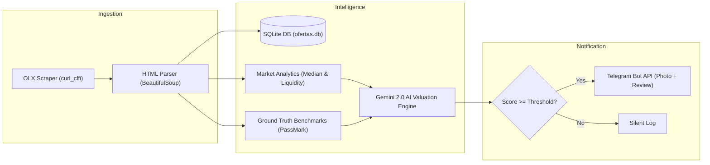

# 🔍 Garimpo OLX Bot

<p align="center">
  
</p>

<p align="center">
  <a href="https://www.python.org/"></a>
  <a href="https://ai.google.dev/"></a>
  <a href="https://core.telegram.org/bots"></a>
  <a href="https://www.sqlite.org/"></a>
</p>

Autonomous deal hunter and market intelligence bot for OLX. Scrapes target queries in real-time, calculates statistical market pricing, correlates hardware specs with factual PassMark benchmarks, scores deals with Google Gemini AI, and dispatches rich Telegram alerts.

---

## Architecture Overview



The bot operates continuously with zero human intervention:
1. **Scraping Engine:** Fetches live search queries on OLX using browser-mimicking headers via `curl_cffi`.
2. **Noise Filtering:** Identifies and filters out false positives (e.g. complete gaming rigs when searching for standalone GPU parts).
3. **Market Analytics:** Analyzes scraped historical data to calculate median prices, factual discounts, liquidity rating, and estimated turnover time.
4. **Factual Grounding:** Cross-references GPUs with real PassMark G3D scores, TDP, and PCIe power requirements to avoid AI hallucinations.
5. **AI Deal Scoring:** Prompts Google Gemini with factual market data to evaluate deal tier (Tier S, A, B, C) and generate a concise verdict.
6. **Telegram Dispatch:** Delivers instant alerts containing the product image, price, discount percentage, benchmark comparison, and direct link.

---

## Key Features

* **Multi-Search Monitoring:** Concurrently monitors multiple queries with customized price ceilings per search.
* **Smart Noise Rejection:** Cleanses outlier prices and irrelevant listings before processing.
* **PassMark GPU Ground Truth:** Embedded database with benchmark scores and power requirements for GPUs from legacy GT series to RTX 40/50 series.
* **Console & Retro Market Data:** Specialized heuristics for handhelds (PS Vita, 3DS, Switch, PSP).
* **Interactive Telegram Interface:** Manage target searches directly through Telegram bot commands.
* **Production-Ready Daemon:** Built-in systemd unit support for continuous 24/7 server deployment.

---

## Project Structure

```text
garimpo/
├── assets/
│   └── banner.jpeg      # Project illustration banner
├── monitor.py           # Main monitoring daemon, scrapers, and Telegram dispatcher
├── market_analytics.py  # Statistical pricing, median calculation, and liquidity ratings
├── benchmarks.py        # Hardware database with PassMark scores and specs
├── requirements.txt     # Python dependencies
├── .env.example         # Template for environment variables
└── ofertas.db           # SQLite database (auto-generated at runtime)
```

---

## Getting Started

### Prerequisites

* Python 3.10 or higher
* Telegram Bot Token (obtained from [@BotFather](https://t.me/BotFather))
* Google Gemini API Key (obtained from [Google AI Studio](https://aistudio.google.com/))

### Installation

1. **Clone the repository:**
   ```bash
   git clone https://github.com/Guilherme-L-C/garimpo-olx-bot.git
   cd garimpo-olx-bot
   ```

2. **Create and activate a virtual environment:**
   ```bash
   python3 -m venv venv
   source venv/bin/activate
   ```

3. **Install dependencies:**
   ```bash
   pip install -r requirements.txt
   ```

4. **Configure environment variables:**
   ```bash
   cp .env.example .env
   ```
   Edit `.env` and fill in your credentials:
   ```env
   TELEGRAM_TOKEN="your_telegram_bot_token_here"
   GEMINI_API_KEY="your_gemini_api_key_here"
   INTERVALO_SEGUNDOS=90
   ```

---

## Running the Application

### Manual Execution

```bash
python monitor.py
```

### Running as a System Service (systemd)

To keep the monitor running continuously in the background on a Linux server:

1. Create a service file `/etc/systemd/system/garimpo.service`:
   ```ini
   [Unit]
   Description=Garimpo de Ofertas OLX Monitor
   After=network.target

   [Service]
   Type=simple
   User=username
   WorkingDirectory=/path/to/garimpo-olx-bot
   Environment=PYTHONUNBUFFERED=1
   ExecStart=/path/to/garimpo-olx-bot/venv/bin/python -u /path/to/garimpo-olx-bot/monitor.py
   Restart=always
   RestartSec=15

   [Install]
   WantedBy=multi-user.target
   ```

2. Enable and start the service:
   ```bash
   sudo systemctl daemon-reload
   sudo systemctl enable garimpo.service
   sudo systemctl start garimpo.service
   ```

3. Inspect live logs:
   ```bash
   journalctl -u garimpo.service -f
   ```

---

## Telegram Bot Commands

The bot supports direct slash commands as well as natural language parsing via Google Gemini.

| Command | Description |
| :--- | :--- |
| `/start` or `/help` | Displays welcome message and quick-start instructions |
| `/top` or `/tiers` | Shows overall leaderboard of top-scored deals (Tier 8 to 10) |
| `/tierlist` | Summarizes top deals specifically for your active monitored searches |
| `/list` | Lists all your active search alerts and their respective IDs |
| `/add <query> [max_price]` | Adds a new search alert (e.g. `/add RTX 3060 1200`) |
| `/del <id>` | Deletes an active search alert by its ID (e.g. `/del 3`) |

> **Natural Language Support:** You can also chat naturally with the bot (e.g., *"Quero monitorar PS Vita até 450 reais"*), and Gemini will extract the search query and price ceiling automatically.
